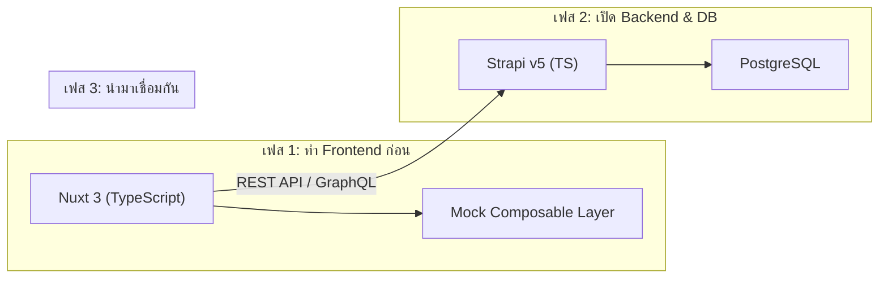

# 🌿 VERDANT // LABS — Spatial Enterprise & AI Architecture
> **สถาปัตยกรรมเว็บไซต์ Headless (API-First) เต็มรูปแบบด้วย TypeScript ทั้งระบบ**
> 
> **Frontend:** Nuxt 3 (Vue 3) + Tailwind CSS โทนสีเขียวอ่อน (Bio-Mint & Architectural Emerald)  
> **Backend:** Strapi v5 (Headless CMS - TypeScript)  
> **Database:** PostgreSQL 16  
> **DevOps:** Docker & Docker Compose  

---

## 🗺️ แผนการทำงาน (Development Plan & Roadmap)

ตามโจทย์ที่คุณต้องการ **"ทำ Frontend ก่อน แล้วค่อยทำ Backend ทีหลัง แล้วค่อยนำมาเชื่อมกัน"** เราจึงออกแบบระบบเป็น 3 ระยะ (Phases) ดังนี้:



### 📌 ระยะที่ 1: พัฒนา Frontend ก่อน (สถานะ: พร้อมรันได้ทันที!)
- โครงสร้าง Frontend ถูกวางระบบไว้ในโฟลเดอร์ `frontend/`
- มี **Mock Composable Layer (`frontend/composables/useStrapiContent.ts`)** จำลองข้อมูล Schema เดียวกับ Strapi API 100% 
- **ข้อดี:** คุณสามารถปรับแต่งหน้าตา สีเขียวอ่อน คอมโพเนนต์ และ WebGL 3D ได้เลย โดยไม่ต้องเปิด Strapi หรือกังวลเรื่อง Backend error
- สิทธิ์และชนิดข้อมูลถูกล็อกด้วย **TypeScript (`frontend/types/strapi.ts`)** ทั้งหมด

### 📌 ระยะที่ 2: เริ่มต้น Backend (Strapi + PostgreSQL)
- โครงสร้างและคอนฟิก Strapi (TypeScript) เตรียมพร้อมไว้ในโฟลเดอร์ `backend/`
- คอนฟิกการเชื่อมต่อกับ PostgreSQL ผ่าน Docker Network แบบอัตโนมัติ
- มี Content Type Schemas เตรียมไว้ล่วงหน้า (`capability`, `case`, `inquiry`) พร้อมฟังก์ชัน Seed ข้อมูลเบื้องต้นใน `src/index.ts`

### 📌 ระยะที่ 3: ปลดล็อกการเชื่อมต่อทั้งระบบ
- `useStrapiContent.ts` จะตรวจสอบการออนไลน์ของ Strapi อัตโนมัติ หาก backend พร้อมทำงาน จะเปลี่ยนจากการใช้ Mock Data ไปดึงข้อมูลสดจาก Strapi API ทันทีโดยไม่ต้องแก้โค้ดคอมโพเนนต์

---

## 📂 โครงสร้างโฟลเดอร์โปรเจกต์ (Project Structure)

```text
newigenco1/
├── docker-compose.yml              # ควบคุมทั้งระบบ (Postgres + Strapi + Nuxt)
├── docker-compose.frontend.yml     # สำหรับรันเฉพาะ Frontend อย่างเดียวในช่วงแรก
├── .env.example / .env             # ตัวแปรสภาพแวดล้อมรวม
├── README.md                       # คู่มือการใช้งานระบบ
│
├── frontend/                       # Nuxt 3 (Vue 3 + TypeScript)
│   ├── package.json
│   ├── tsconfig.json
│   ├── nuxt.config.ts              # คอนฟิก Nuxt, Tailwind, Google Fonts
│   ├── tailwind.config.ts          # กำหนดชุดสีเขียวอ่อน (Mint/Emerald/Forest Ink)
│   ├── Dockerfile                  # Production Multi-stage Build
│   ├── Dockerfile.dev              # Development Build พร้อม Hot Reload
│   ├── assets/
│   │   └── css/
│   │       └── main.css            # Glassmorphism, Architectural Grid, Custom Cursor
│   ├── types/
│   │   └── strapi.ts               # Shared TypeScript Data Interfaces
│   ├── composables/
│   │   ├── useTheme.ts             # จัดการ Light/Dark Theme, X-Ray Mode, HUD
│   │   └── useStrapiContent.ts     # Headless API Fetcher + Graceful Mock Fallback
│   ├── components/
│   │   ├── AppHeader.vue           # HUD Bar, Live Clock, Depth Telemetry, X-Ray
│   │   ├── FloatingDock.vue        # VisionOS / macOS Floating Dock Navigation
│   │   ├── HeroSection.vue         # Asymmetric Editorial Kinetic Hero
│   │   ├── WebglBackdrop.vue       # Three.js 3D Morphing Liquid Emerald Knot
│   │   ├── KineticBand.vue         # Diagonal Velocity Marquee Strip
│   │   ├── CapabilityModules.vue   # Staggered 01-04 Spatial Architecture Cards
│   │   ├── AiSynthesizer.vue       # Interactive AI Strategy & ROI Calculator
│   │   ├── ShowcaseTrack.vue       # Horizontal Scroll Flagship Showcase
│   │   └── ContactFooter.vue       # Brutalist Contact Form & Terminal Footer
│   └── pages/
│       └── index.vue               # หน้าหลักรวมทุกคอมโพเนนต์
│
├── backend/                        # Strapi v5 (Headless CMS - TypeScript)
│   ├── package.json
│   ├── tsconfig.json
│   ├── Dockerfile & Dockerfile.dev
│   ├── config/
│   │   ├── database.ts             # เชื่อมต่อ PostgreSQL ผ่าน Environment
│   │   ├── server.ts
│   │   ├── admin.ts
│   │   └── api.ts
│   └── src/
│       ├── index.ts                # Bootstrap & Auto-seed Script
│       └── api/                    # Content Types (capability, case, inquiry)
│
└── database/
    └── init/
        └── 01-init.sql             # สคริปต์เตรียมฐานข้อมูล PostgreSQL
```

---

## 🚀 วิธีการรันโปรเจกต์ (Step-by-Step Execution)

### ทางเลือกที่ 1: รันเฉพาะ Frontend ด้วย Docker (แนะนำสำหรับตอนนี้)
คุณสามารถรันเฉพาะส่วนหน้าบ้านเพื่อดูหน้าตาและตกแต่งต่อได้ทันที:

```bash
docker-compose -f docker-compose.frontend.yml up --build
```
> เปิดเบราว์เซอร์ไปที่: **http://localhost:3000**

---

### ทางเลือกที่ 2: รัน Frontend ในเครื่องโดยตรง (Local Node.js)
```bash
cd frontend
npm install
npm run dev
```
> เปิดเบราว์เซอร์ไปที่: **http://localhost:3000**

---

### ทางเลือกที่ 3: รันทั้งระบบพร้อมกัน (เมื่อพร้อมทำ Backend)
เมื่อต้องการเริ่มทำส่วนของ Strapi Backend และ PostgreSQL:

```bash
docker-compose up --build
```

**Services ที่จะพร้อมใช้งาน:**
| บริการ | หน้าที่ | URL / Port |
| :--- | :--- | :--- |
| **Frontend** | Nuxt 3 Web App | [http://localhost:3000](http://localhost:3000) |
| **Backend** | Strapi Headless CMS | [c](http://localhost:1337/admin) |
| **Database** | PostgreSQL | `localhost:5432` |

---

## 🎨 โทนสีและดีไซน์ (Design System & Color Palette)

ดีไซน์ออกแบบในคอนเซ็ปต์ **"Architectural Bio-Emerald & High-Contrast Light Green"**:

- **Lab White (`#F6F9F7`):** สีพื้นหลังสไตล์ห้องแล็บ สะอาด สว่าง ตาไม่ล้า
- **Forest Ink (`#022C22`):** สีข้อความเข้มลึก คมชัด อ่านง่าย ไม่ใช้สีดำสนิท
- **Bio Mint (`#00FF88`):** สีเขียวมิ้นต์นีออน สำหรับไฮไลต์และ Dark mode
- **Electric Green (`#00D26A` / `#00C864`):** สีเขียวมรกตสำหรับปุ่ม CTA และจุด Focus
- **Cyber Obsidian (`#020806`):** สีพื้นหลังเมื่อกดสลับเป็นโหมดมืด (Dark Mode)

---

## 🔑 การตั้งค่าสิทธิ์ Strapi เมื่อเปิดใช้งาน (Permissions Setup)
เมื่อรัน Strapi เป็นครั้งแรก:
1. เข้าไปที่ `http://localhost:1337/admin` และสร้างบัญชี Super Admin
2. ไปที่เมนู **Settings** -> **Users & Permissions Plugin** -> **Roles**
3. เลือก Role **Public**
4. ติ๊กเครื่องหมายถูกที่:
   - `Capability` -> `find`, `findOne`
   - `Case` -> `find`, `findOne`
   - `Inquiry` -> `create`
5. กด **Save** ด้านขวาบน หน้าบ้าน Nuxt 3 จะสามารถดึงข้อมูลและส่งฟอร์มเข้า Strapi ได้ทันที
